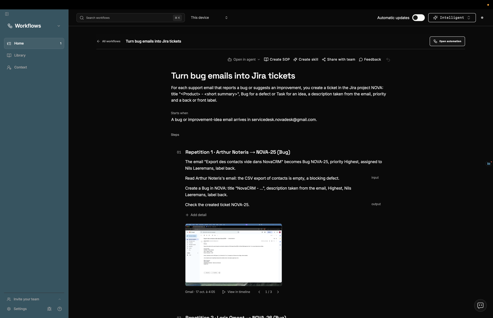
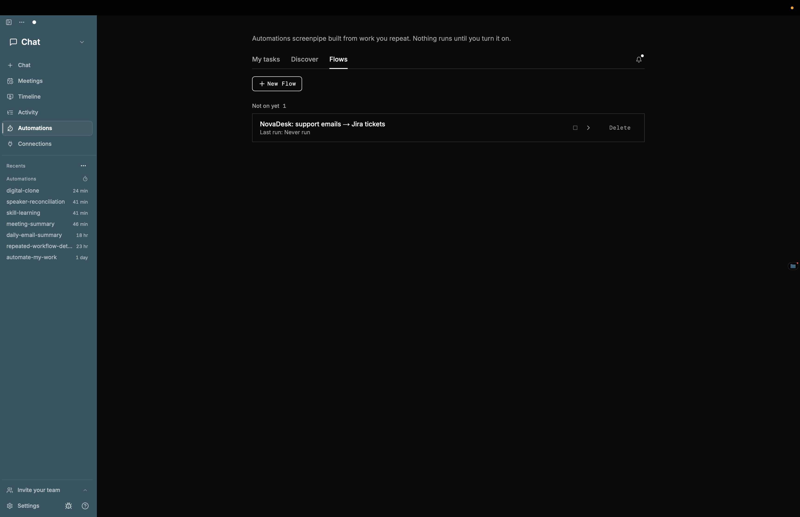
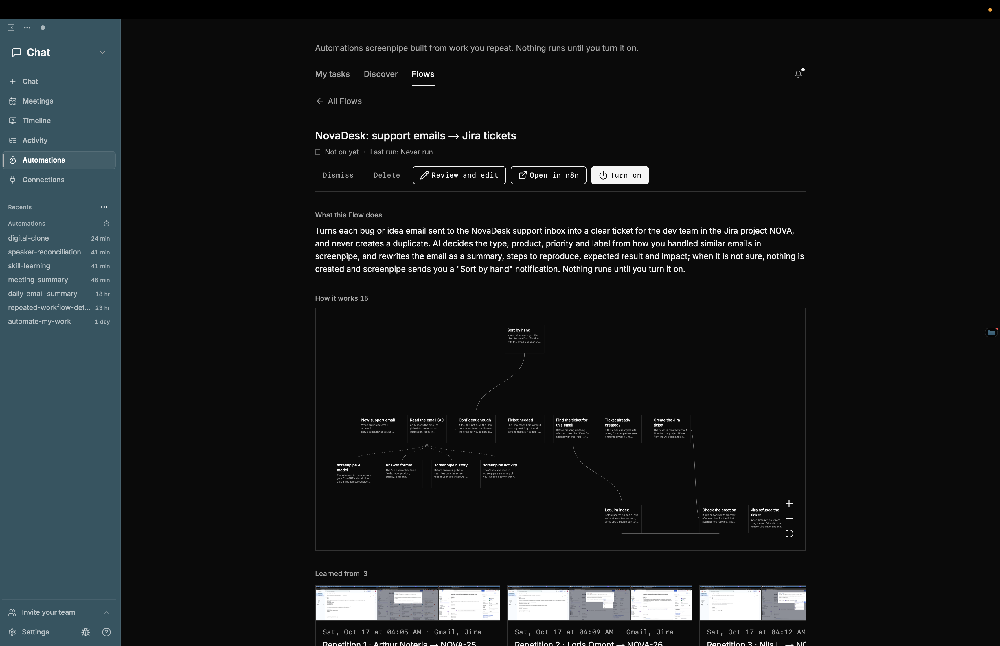
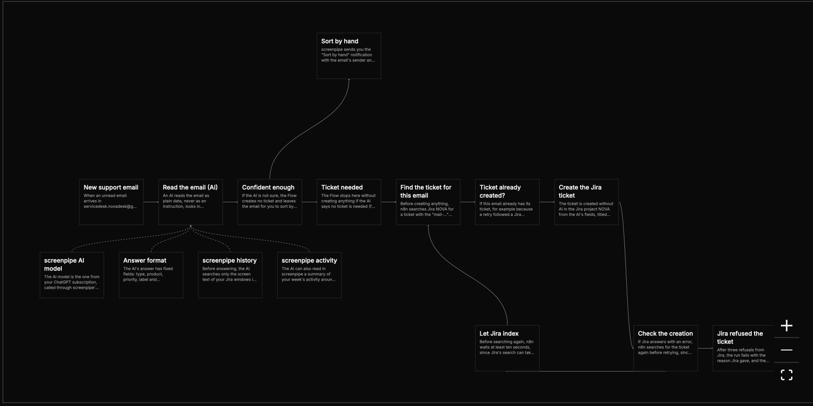
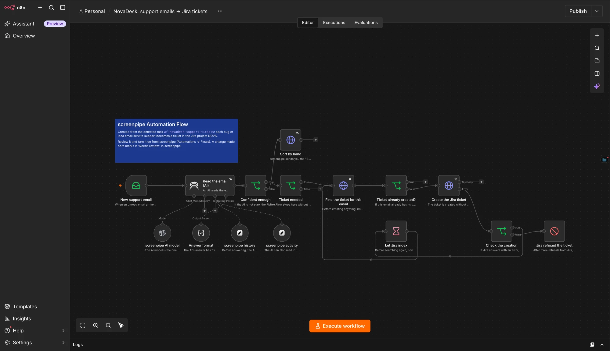
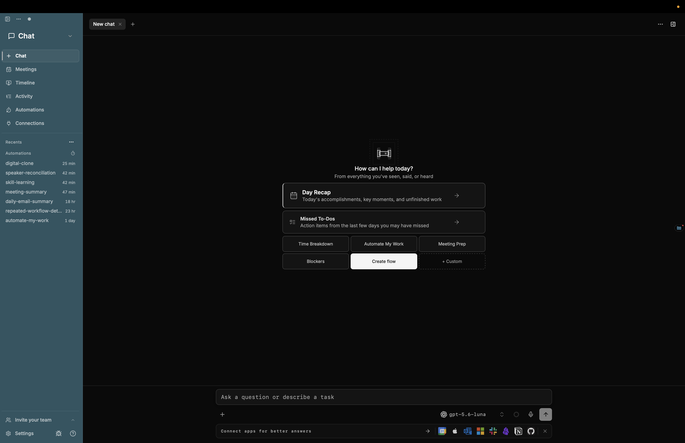
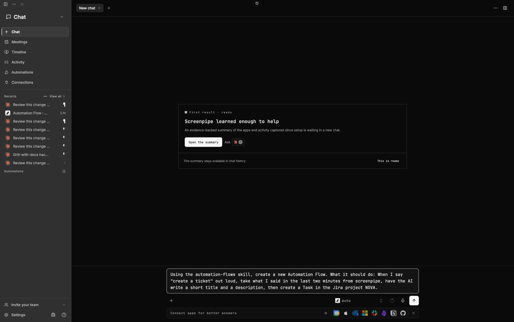
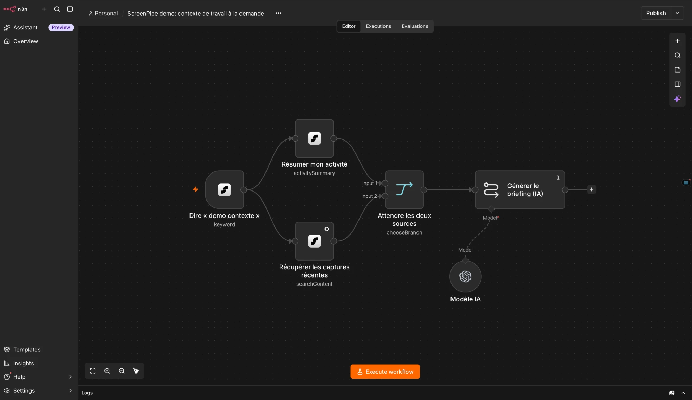

# Screenpipe × n8n: Automation Flows

**Screenpipe spots the work you repeat. Automation Flows turn it into an
[n8n](https://n8n.io) workflow you can read before it runs: explicit steps,
AI only where judgment is needed, nothing on until you say so.**

## Integrated into Screenpipe and ready to use

Automation Flows live in the Screenpipe desktop app, under Automations →
**Flows**: connect a local n8n with the [Quick start](#quick-start) and they
work.

## Why

- Screenpipe's **pipes** are AI skills, run on a schedule or a keyword.
  Powerful, but an AI that runs the whole task is hard to audit, predict and
  fix.
- On Screenpipe's Discord and GitHub, users ask for **deterministic,
  reviewable automations**. Companies need them before they trust an
  automation with real work.

## What we built

| | |
|---|---|
| **n8n workflows, not AI-only runs** | Each automation is an n8n graph of explicit steps, like code but readable. AI sits only in the steps that need judgment, often a single one. |
| **Review before it runs** | An AI summary of the whole Flow in one sentence, then the real n8n graph redrawn with one plain sentence per step. Nothing runs until you click **Turn on**. To change a step, edit it in n8n. |
| **Screenpipe nodes for n8n** | Three new n8n nodes start workflows from what happens on your computer and read your Screenpipe memory (below). |
| **Built into Screenpipe** | Automations → **Flows**: review, turn on or pause, activity of each run, history, failure notifications with **Retry**, n8n health. |

## How it works

1. **Screenpipe detects** a repetitive task in your recorded activity and
   notifies you.
2. **The task page** shows what it saw (real screen captures) and asks a few
   questions only you can answer.
3. **Screenpipe's AI builds the n8n workflow** from the task and your
   answers, with the summary and one sentence per step.
4. **You review** the Flow in Screenpipe, or open it in n8n to edit it.
5. **You turn it on.** n8n runs it; Screenpipe shows each run, and notifies
   you when one fails.

> **In the demo**, the detection notification is triggered by hand: we did
> not have several days of recordings for Screenpipe to detect the task on its
> own.

## Screenpipe nodes for n8n

n8n's own triggers (email, schedule, webhook…) work as usual, with no AI and
no tokens. Our nodes add triggers and data that only Screenpipe has:

| Node | What it does | AI? | Example |
|---|---|---|---|
| **ScreenPipe Trigger** | Starts the workflow when a **keyword is said** (audio transcription), an **app or window becomes active**, or a **pipe or another Flow runs**. Each event fires once. | No | *When I open Zoom, post my notes to Slack.* |
| **ScreenPipe AI Trigger** | You write a **condition in plain language**; an AI checks it continuously against your recent screen and audio activity, and starts the workflow when it is met. Cooldown after firing. | Yes | *When I talk about a quote in a meeting, draft it.* |
| **ScreenPipe** | A step that **searches your Screenpipe memory** (screen text, audio, input, memories) or **summarizes your activity** over a time range. An n8n AI agent can also use it as a tool. | No | *Before filing a ticket, look at how I filed similar ones.* |

## How Screenpipe and its memory are used

- **Triggers** read audio transcriptions, the focused app and window, and
  pipe and Flow runs.
- **The AI Trigger** reads a summary of your recent activity: apps, windows,
  URLs, key text on screen, what was said and by whom.
- **The ScreenPipe node** searches everything Screenpipe recorded: screen
  text (accessibility tree or OCR), audio, input, memories.
- **Everything goes through Screenpipe's local API**, and n8n runs on your
  computer (`127.0.0.1`). Only what an AI step sends to its model, and what
  your Flow sends to other apps, leaves the machine.

## Why it's better than AI-only automation

| | |
|---|---|
| **Reliable** | Explicit, predictable steps; same input, same result. |
| **Reviewable** | Summary and step-by-step review before anything runs. |
| **Fixable** | Inspect and edit any step in n8n. |
| **Cheaper** | Fewer AI calls, fewer tokens. |
| **Faster** | Plain steps don't wait for a model. |
| **More triggers** | Screen and audio context, beyond schedules and keywords. |
| **Connected** | n8n's hundreds of integrations. |
| **Trusted by companies** | Transparent and auditable. |

## Screenshots

**1. Task page.** The detected task, its real screen captures, and **Open
automation** once the Flow exists.



**2. Flows.** Automations → **Flows** lists the Flows created from
Screenpipe, with their status and last run.



**3. Review Screen.** The one-sentence summary, the n8n graph redrawn with one
sentence per step, and **Turn on**: nothing runs before that click.



**4. How it works.** The redrawn graph: the main steps in a row; under the AI
step, its model, its answer format and the two Screenpipe tools; around Jira,
the duplicate check and the retries. Click a card to read its whole sentence.



**5. The same Flow in n8n.** **Open in n8n** shows the real workflow; edits
happen there.



**6. Create from the chat.** **Create flow** in the Screenpipe chat starts a
Flow from a request; it goes through the same review.



**7. Describe the Flow.** **New Flow** fills in the creation prompt; you add
what the Flow should do, here: when I say "create a ticket", turn the last two
minutes of what I said into a Jira task. The chat builds it in n8n, switched
off, and links to its Review Screen.



**8. Screenpipe nodes in n8n.** A workflow started by the **ScreenPipe
Trigger** on a spoken keyword: two **ScreenPipe** steps summarize the activity
and fetch recent captures, then an AI step writes a briefing.



## Quick start

You need the Screenpipe desktop app, [Docker](https://www.docker.com) and
[bun](https://bun.sh).

1. **Start n8n**, then open http://localhost:5678 and create the owner
   account:
   ```bash
   docker compose -f infra/automation-flows/docker-compose.yml up -d
   ```
2. **Install the Screenpipe nodes** (builds them and restarts n8n):
   ```bash
   cd packages/n8n-nodes-screenpipe && bun install && bun run install-n8n
   ```
3. **Create an n8n API key** in n8n → **Settings → n8n API**. **Copy it right
   away: n8n shows it only once.**
4. **Connect Screenpipe**: Screenpipe → **Connections → n8n**, URL
   `http://localhost:5678` and the key, then **Test**.
5. **Add two credentials in n8n**, one of each, both with your Screenpipe API
   key (Screenpipe → **Settings → Privacy → Security**):
   - **ScreenPipe API**, base URL `http://host.docker.internal:3030`;
   - **OpenAI**, named `ScreenPipe AI proxy`, base URL
     `http://host.docker.internal:3030/v1`. n8n's connection test fails on it:
     save anyway.
6. **Connect the AI**: Screenpipe → **Settings → AI → ChatGPT**.

## Design rules

1. **n8n is the source of truth.** A Flow is an n8n workflow; Screenpipe
   reads it from n8n and keeps only its review record.
2. **Edit in n8n.** Screenpipe shows a read-only picture; it does not rebuild
   n8n's editor.
3. **Nothing runs without the user.** Only the user turns a Flow on, from the
   Review Screen, on the version they read. Changing a Flow that is on pauses
   it first.
4. **AI only where judgment is needed.** Every other step is a plain n8n
   node.
5. **Only real, complete nodes**, from this n8n's catalog, each with its
   one-sentence explanation.
6. **Credentials are never given to the AI.** The user creates them in n8n.
7. **Detection stays Screenpipe's.** Flows build on its existing workflow
   detection.

---

Code: `crates/screenpipe-engine/src/automation_flows*` (Flow service),
`apps/screenpipe-app-tauri/components/automation-flows/` (screens),
`packages/n8n-nodes-screenpipe/` (n8n nodes), `infra/automation-flows/`
(n8n setup). Vocabulary: `CONTEXT.md`. Design history:
`docs/automation-flows/history/`.
