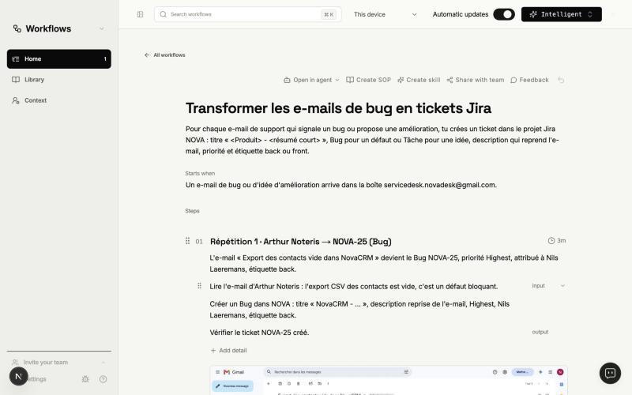
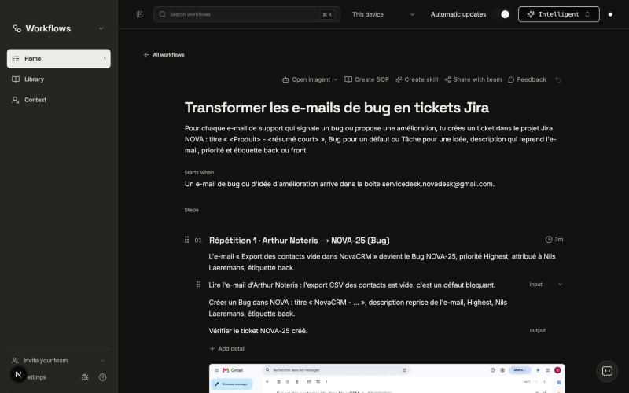
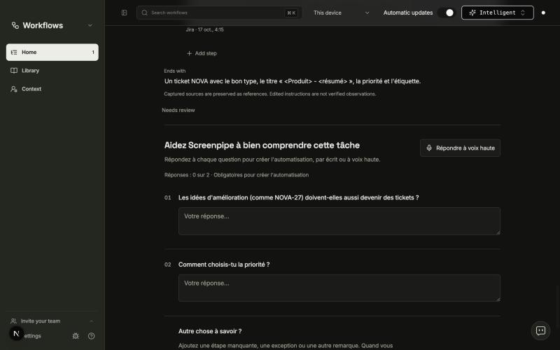
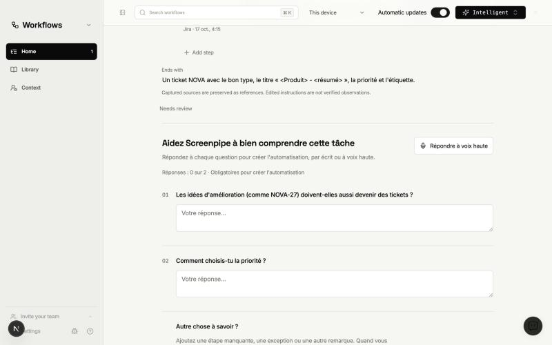

# 02: Workflows view follows the app theme

**What to build:** The Workflows view (detected tasks, the Task Page, the evidence timeline, the clarification questions and « Créer l'automatisation ») is dark when the app is dark and light when it is light, with no white surface left in dark mode.

Spec: `docs/automation-flows/history/hackathon/issues/27-flows-round-two.md`.

**Blocked by:** None (can start immediately)

**Status:** done, live check pending: open the Task Page and the Workflows library in the native app in dark and in light mode (Settings → theme), and check the access / automatic-updates dialogs.

- [x] Every hard-coded light colour in the view is replaced by theme tokens that follow the app's `dark` class.
- [x] No forced light colour scheme remains on inputs or selects.
- [x] A component test renders the view under the dark class and finds no hard-coded light surface.
- [x] Before/after screenshots in dark and light mode are added to the ticket.

## What changed

- `packages/workflows-ui/src/workflows-app.module.css`: the palette on `.app`
  becomes a full token set (ink, on-ink, ink-soft, muted, faint, line,
  line-strong, paper, panel, soft, sunk, warm, danger, ok…) with a
  `:global(.dark) .app` override. Every colour literal in the package's CSS
  modules now points at a token (shadows with black alpha stay). Active and
  primary controls invert in dark mode (light fill, dark text), like the
  app's own primary buttons; the brand mark stays ink with its lime bars.
- `color-scheme: light` removed from the question block and the export
  checkbox; `colorScheme: "light"` removed from the « Workflow source » select.
- The access notice, the automatic-updates prompt and the cloud processing
  prompt (dialogs portalled outside `.app`) no longer force a white palette;
  they use the app's own tokens.
- Light mode is visually unchanged (neutral shades are quantized to the
  nearest token).

## Screenshots (browser mock, demo Task Page)

| | Before | After |
|---|---|---|
| Dark, top |  |  |
| Dark, questions |  |  |
| Light, questions |  |  |

## Tests run

- `cd apps/screenpipe-app-tauri && NODE_OPTIONS=--no-experimental-webstorage bunx vitest run components/workflows/workflows-view-theme.test.tsx`:
  5 passed (red before the change: 35 light surfaces on the Task Page, 18 in the
  integrated view incl. the forced-light select, white access and
  automatic-updates dialogs). The test injects the package's real CSS modules
  into jsdom, resolves `var()` and flags any light neutral fill or forced light
  colour scheme; a light-mode case guards the detector.
- `NODE_OPTIONS=--no-experimental-webstorage bunx vitest run components/workflows lib/workflows components/automation-flows`:
  61 files, 606 passed, 1 skipped.
- `bunx tsc --noEmit -p .` (app): no errors in the touched files.
- Node 26 needs `NODE_OPTIONS=--no-experimental-webstorage` for jsdom's
  localStorage (pre-existing environment issue).
