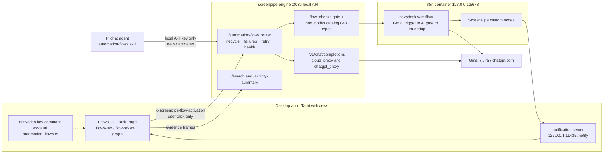

# Comprehensive review — PR #1 (arthrod/screenpipe), "Automation Flows"

Produced by the lead reviewer from **135 integrated reviewer-slice summaries** (87 slices with
PR-diff findings, 48 phantom slices whose files live only on the base branch, plus in-slice
mini-phantoms). Every factual claim below traces to a slice summary that verified it in-session
(slice numbers in brackets); nothing was independently re-executed at the lead layer. Commands
quoted are the ones the cited slices ran.

---

## 1. What this PR is

- **Identity:** cross-repository fork PR `KylianAUBRY/screenpipe_LH:main` @ `0b6c5f9d1` →
  `arthrod:main` @ `d75ccaedd`; merge-base `35ed62162` (2026-10-16 21:49 UTC); title `kkkk`;
  body an unfilled template. **234 files, +34,606/−600**; 315 commits ahead, **41 commits
  behind** base; GitHub reports **`mergeable: CONFLICTING` / `DIRTY`**; the PR's own checks are
  fork-blocked (`gh pr checks 1` → PandaCI fail "Pull requests from forks are not currently
  supported") — so **no CI signal has ever run on this PR** [4,9,10,14,51,62,81,106,121].
- **Content:** the Automation Flows hackathon feature drop, end to end — an n8n-backed
  automation system with a chat skill, a desktop Review Screen, three custom n8n nodes, a local
  n8n stack, a scripted demo, and ~87 files of design history. A third of the PR by file count
  is documentation (docs 87, apps 78, packages 28, crates 20, infra 16, root 5) [87].

## 2. The story, area by area

**Engine (`crates/screenpipe-engine`, the PR's core).** A new 2,246-line `automation_flows.rs`
plus five submodules (`failures`, `retry`, `health`, `activity`) and two companions
(`flow_checks.rs` 587 lines, `n8n_nodes.rs` 337). n8n is the workflow source of truth; the
engine keeps only a review-record store and exposes 15 local routes. Its security spine is a
per-process UI activation credential (`FlowActivationKey`, two UUIDv4s, constant-time compare,
`from_user` gate at `automation_flows.rs:1459-1464`) so **only a desktop-webview click can turn
a Flow on** — chat agents, pipes, and MCP clients share only the local API key and are refused
(403 `activation_requires_user`), `availableInMCP` is stripped from n8n payloads, retry is
credential-gated, and drafts under construction are activatable by nobody [23,42,46,54,61,69,90,93].
`flow_checks.rs` refuses invented/disabled/incomplete nodes against a catalog generated from the
live n8n image (843 entries; browsing layer ≡ check layer verified in both directions) [47,68,97,105].
A new 934-line `chatgpt_proxy.rs` routes `chatgpt/<model>` requests to the user's ChatGPT
subscription via the Codex API, dispatched from `cloud_proxy.rs:34-35` [57,63,66].

**Desktop app (`apps/screenpipe-app-tauri`).** The Flows tab and Review Screen
(`components/automation-flows/`), the Task-Page creation flow, notification retry wiring,
the `screenpipe://flows` deep-link chain, and the src-tauri half: the activation-key command,
the ⌃⌥⌘D demo chord (`shortcuts.rs`), and a new app-origin block in the owned browser
(`owned_browser.rs:1609-1627`). The UI↔engine contract was verified field-for-field
(routes, wire casing, all 12 error codes, health vocabularies) [65].

**Shared package (`packages/workflows-ui`, 12 files).** Creation-mode questions, the
one-at-a-time evidence carousel, a dark-theme token migration, and a +10/−1 `screenshots.ts`
change admitting embedded negative-frameId demo screenshots — the smallest change with the
largest blast radius (see Findings).

**n8n nodes package (`packages/n8n-nodes-screenpipe`, new).** Three nodes (ScreenPipe with
search/summary/notify, ScreenPipeTrigger with per-source cursors, ScreenPipeAiTrigger), a
credential, a guard-railed build/install pipeline into the compose-mounted `custom-nodes/`, and
a genuinely outside-in test suite (real HTTP harness, prompt-injection fence, no-key-leak
assertions) [99,101,106,108,110,117].

**Infra (`infra/automation-flows`).** Loopback-only compose pinning n8n 2.42.2, a fail-closed
import script, the catalog generator, and the demo tooling (`demo.ts`, `reset.ts`) whose
duplicate-safety story (FNV-1a mail labels, check-before-retry) is verified at four layers and
pinned by 65 local tests — that no CI job runs [67,91,98,100,112].

**Chat skill (`crates/screenpipe-core/assets/skills/automation-flows/`).** SKILL.md +
n8n-guide.md, wired chat-only in `pi.rs` (pipe path provably excludes it; forbidden-token sweep
tested; every ```json guide example compiled into the engine test suite via `include_str!`)
[42,102].

**Docs (87 files).** SPEC, a 2,325-line raw transcript, 27+17 ticket records, live-check
evidence, prototypes. Mostly honest and unusually verifiable (27-of-30 and 34-of-40 spot-check
rates) — but systematically frozen before same-PR rewrites (see Findings) [114,119,120,122,124,127,129,132,133,134].



## 3. Findings that matter

### P1 — merge-state (blocking)

`git merge-tree --write-tree origin/main HEAD` → exit 1, exactly **5 conflicts**:
`workflows-app.tsx`, `workflows-app.module.css`, `workflow-step-evidence.tsx`,
`workflow-step-evidence.module.css`, `step-evidence.test.tsx` [10,51,70]. Slice 51 simulated
both naive resolutions in a /tmp harness: **take-main silently drops ~355 lines of this PR's
flows UI** (pinned task header, `OpenAutomationButton`, review-request reload, `timelineLabel`);
**take-PR breaks two upstream tests** with reproduced failures (`library.test.tsx:94` "Open SOP"
menu; `local-editor-parity.test.tsx:145` archived-hidden default). Only a hand-union guided by
slice 51's port list works. Separately, `bun run coverage:all:check` — the exact CI command —
**fails at head** (7 new engine files / ~143 test blocks unmapped in
`docs/coverage/core-engine-map.json`; passes on origin/main in a worktree) [121], and the
PR's CI is fork-blocked, so neither the conflicts nor the red gate ever surfaced [106].
A post-sync semantic pass is also required: the PR's flows code has never been compiled
against main's #7634 required-redaction gating, and `/frames`+`/search` can now return
503 `privacy_pending` that the flows evidence paths have never seen [41,53,74].

### P1 — the three "silent guarantee violations"

1. **Email loss on pause:** `is_running` polls n8n with `status=running` only
   (`automation_flows.rs:847`) while the same file maps `new|waiting` as mid-flight (`:802-809`)
   and n8n's docs confirm those are real statuses — an email held in a Wait node is dropped by
   `unpublish`, exactly what `RunningWait` exists to prevent. Slices 23 (P2) and 46 (P1, with
   the three-way internal inconsistency) — **P1 adopted on 46's evidence**. The UX half: the
   Pause copy invites a second click that force-unpublishes mid-execution
   (`flow-activation.tsx:17-18`; engine comment `automation_flows.rs:186-189`) [40]; the demo
   `reset.ts:87-91` also unpublishes without waiting [100].
2. **Failure notifications silently eaten:** every 2xx except the exact string
   `"Notification sent successfully"` is classified `Undelivered::Gated` — terminal, never
   retried (`failures.rs:332`) — but the app's suppression paths (quiet hours, pause, mute)
   return *before* writing history and the notice is `type: "pipe"` with no punch-through, so
   **a run failing during quiet hours is reported nowhere, ever** [75]. Mirror images: the same
   failing *trigger* notifies on every 5-second poll (timestamped id, execution-keyed ledger)
   [90], and the recovered-duplicate path notifies nobody at all [91].
3. **Review-Screen information fidelity:** the demo task claims `confidence: 0.9`,
   `visualVerified: true`, `catalogStatus: "current"` with no provenance field, installs into
   the **real** catalog, is rank-1, and is fully eligible for the genuine review-notification
   loop (`detected-task.ts:166,194,205-216`; `workflow.rs:34-46`) — combined with the
   unconditionally registered demo chord (`shortcuts.rs:527-536`, CodeRabbit Major), any
   production screen can acquire a "detected task" for work that never happened [37]. Around
   it: the Learned-from section renders load errors as "no repetitions" [50], counts stages as
   repetitions [50], the graph draws disabled nodes as active steps and overlaps two-level
   context chains 100% (reproduced by running the file's own layout functions) [71].

### P1 — security and privacy

4. **Windows subframe IPC bypass:** wry 0.55.1 wires only `NavigationStarting`, never
   `FrameNavigationStarting` (verified in the vendored registry source), so on Windows an
   iframe to `http://tauri.localhost/` bypasses the app-origin block
   (`owned_browser.rs:584-594`) while `capabilities/main.json` grants `windows: ["*"]` +
   `local: true` — fs-read on `$HOME/**`, a shell-execute sidecar, http-default [55]. The
   frame-derived-IPC caveat is honestly marked unverified-from-macOS; needs a Windows check.
   Structural fix: scope the capabilities.
5. **Transcript published against its own rule:** `CONVERSATION_NOTES.md:9-10` says "if the
   repository is made public, remove this file first: it contains product strategy" — and the
   repo is PUBLIC (`gh repo view`), so this PR publishes strategy, moat analysis, and an
   internal session id [109,113]. One-file fix.
6. **Doc that inverts a security decision:** round-two doc 12 states retry is "open to any
   local caller (no UI credential)" — the opposite of the shipped credential policy
   (`retry.rs:14-19,35-37`) [132].

### P1 — functional break from a 10-line change

7. **Embedded-screenshot blast radius:** `screenshots.ts:8-20` now admits negative-frameId demo
   screenshots, but unchanged consumers were never taught: `parseGuide` requires
   `frameId >= 0` (`guide.ts:68-71`) so **any guide draft that picks an embedded screenshot
   becomes permanently unsavable** (pre-write validation throws on every save; "Remove
   screenshot" doesn't clear the poison) [130]; the SOP editor shows "no longer available"
   while ignoring the good `dataUrl` (fires with no user action) [130]; video scenes carry
   `imageFrameId: -1` into builders that throw or silently drop the image
   (`guide-video.ts:37-40`, apps `guide-video.ts:78-79`) [123,130]. The fix pattern already
   exists in-PR at `workflow-step-evidence.tsx:114`.
8. **Skill misquote:** `SKILL.md:179` instructs editing `labels: [ $json.output.label ]` — a
   string occurring **zero** times in the shipped workflow (real expression: local `o` binding
   + FNV dedup label); an agent following the skill cannot find the target and may violate the
   skill's own rule 3 [102].

### The P2 layer (90 findings — the shaped clusters)

- **Unbounded waits:** the global `write_lock` held across the 90-second unpublish poll blocks
  every other Flow's mutation (three slices, all lock-takers enumerated) [23,46,54]; health
  draft-cleanup holds it across n8n calls [72]; no timeouts end-to-end on engine routes, the
  cloud proxy's buffered read, the chatgpt token refresh (~35 s before validation), and
  `connect()` [18,57,66,99,110].
- **Timezone-fragile tests:** `flows-tab.test.tsx:790` (and `:419`) hardcode calendar dates for
  02:05Z fixtures — fails everywhere west of UTC−2, quadruple-posted, root-caused: the docs'
  own recorded counts reproduce only under `TZ=Europe/Paris` [20,26,48,50,127,132,133]; CI is
  UTC so it stays green. One of only **two** failures in the full frontend suite (7,090/7,092) [86].
- **Trust-boundary residuals:** the UI credential attaches on retry-URL *shape* (bot's
  provenance Major; the regex also misses absolute-form and — theoretically — encoded ids)
  [39,60,65]; the owner-only edit gate treats unregistered `sp_pipe_*` tokens as user tokens
  (pre-existing) [58]; **delete needs only the shared local API key** — the least-gated
  irreversible operation [90]; `source_moment` reads the catalog without the
  HistoryAccessPolicy filter its own module enforces [58].
- **False-assurance tests:** the theme test scans the catalog-*error* UI and is blind to
  `hsl()`/`color-mix()` and hidden pages — while the shipped UI has a real dark-mode
  invisible-textarea regression and compact-topbar overlap inside those blind spots
  [45,103,111]; the fake n8n accepts any `versionId` and ignores the `loadWorkflow` body on
  the two safety-critical endpoints [78]; notify tests only ever stub 200-success [80];
  the calibration grader for Anthropic never sees cache-token fields [116].
- **Test-infra gaps with root causes:** test files excluded from typechecking (app tsconfig;
  the n8n package's tsconfig covers 4-of-10 files) so fixture annotations are decorative
  [30,31,101]; the 65-test infra suite, the evals, and the n8n package have **no CI wiring**
  [62,81,98,105,112]; the engine's catalog `.expect` panics per request on drift while the
  generator can silently produce that drift [47,97].
- **Docs-staleness family, graded:** frozen-then-rewritten (coverage.md rows 153/155 cite
  tests deleted later *in this PR* by `1955e12b8`; issues 16/19 describe deleted subsystems)
  [129,132,133]; citation rot (all four "(story N)" pointers wrong; ticket count 16 vs 17)
  [120]; frozen-then-superseded (SPEC's "FAILS today" for a fix that shipped; IMAP plan; 30 s
  timeout; BUILD_SPEC stale) [109,113,114,119,122]; **false-at-writing** (issue 02 claims three
  dialogs were tokenized — all three untouched, still forcing white palettes; records 5 tests
  in a 3-test file) [134]. Plus systematic French quotes against an all-English UI
  [114,119,122,129,132,133,134], status enumerations omitting `dismissed` in both CONTEXT.md
  and SKILL.md [12,102], and `api.requestChange` left as dead code [124].

### Process findings about the review itself

- **48 phantom slices** were assigned files that exist only on the base branch: the slice list
  was generated from a two-tip diff or symmetric-difference log (434 files vs the PR's real
  234; mechanisms identified in-session by slices 77, 94, 95) — a full routing postmortem with
  the upstream-commit genealogy (#7634/#7674/#7677/#7695/#7715/#7716, ~2 hours of fork-point
  bad luck on #7634). A silver lining: the accidental side-review of upstream #7634's PII gate
  is nearly complete (code, tests, docs, numbers) with only P3-grade notes [52,53,74,82,83,104,116,118,125,131].
- **Intra-crew duplicate posts** are structural: all reviewers post under the same account,
  which the feedback skill's current-user exclusion hides (root cause identified by slice 76).
  Duplicates to consolidate: timezone ×4, write-lock ×3, is_running ×2, bundle ×2,
  event-constant ×2, success-literal ×3, URL-outside-try ×2, transcript-P1 ×2, staleness ×~13.
- Twelve focus-premise mismatches (nonexistent identifiers, wrong-layer behaviors) — slice
  generation mis-assumed file contents, not just file lists [33,43,45,47,61,69,85,93,103,111,112].

### Verified strengths (worth stating in the PR's favor)

Never-activate is defense-in-depth across four independent layers (engine credential, skill
forbidden-token sweep, chat-only install, MCP stripping) [35,42,54,61,69]; "no invented nodes"
is structural (single generator, both-directions set equality, check-layer backstop) [68,105];
the 5,085-line engine integration suite is genuinely strong and was run green six independent
times (107/107) [54,61,69,73,78,90,119,124,129,132,133]; the demo's duplicate-safety is real
and four-layer verified [91,98]; the chat-link sanitization chain was verified against the
pinned dependency sources themselves [44]; both proxies are SSRF-free by construction [57,66];
credential handling is clean at every layer examined [18,46,54]; pause/resume recording
invariants fail open [77]; the full frontend suite is green except the one timezone line [86].

### Unknowns (stated, not guessed)

Live n8n 2.42.2 semantics — status-filter behavior, retry/queue modes, the DELETE-vs-archive
contradiction between `reset.ts:94` and `automation_flows.rs:874-881`, the error-workflow
label — were never verified against a running instance (Docker was down; docs consulted where
noted) [46,67,72,75,100]. The Windows frame-IPC path needs a Windows host [55]. The `test:bun`
half of the frontend script was never run by any slice. Branch protection on the coverage-gate
job was not audited [121]. No slice confirmed whether main's #7715 already fixes the two red
web evals [81].

## 4. Recommendation

**Go-with-conditions — not mergeable today.** The engineering underneath is real and unusually
well-tested (six green full-engine-suite runs, exhaustive contract parity, defense-in-depth on
the safety invariants), so the work should move forward; but ten P1s — an unresolvable-by-default
merge with a proven-bad naive resolutions, a red CI gate hidden by fork protection, an email-loss
engine bug, a privacy publication violation, and a Windows IPC bypass — plus the fork-blocked CI
mean the PR must not land as-is. Conditions (blocking): merge `origin/main` per slice 51's port
guidance and re-run the post-sync semantic pass; fix the ten P1s (each has a small named fix);
pin `TZ` in CI/tests and land the one-line consumer gates for embedded screenshots; fill the PR
body per AGENTS.md; and restore a CI signal (un-fork or base-side run) including the never-wired
infra/package suites and the coverage map.
